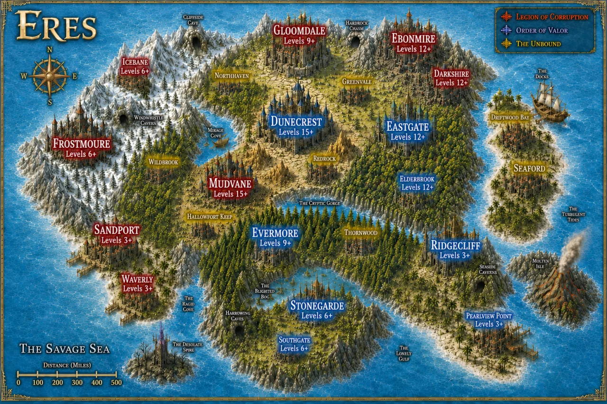

# Territories

Each major city is led by a **City Delegate**, and each minor city by a **City Warden**. The level shown is the character level each city is suited to.

## The Order of Valor

=== "Major cities"

    | City | Level | City Delegate |
    |------|-------|---------------|
    | Ridgecliff | 3+ | Teldros Balgrax (dragonborn) |
    | Stonegarde | 6+ | Kitavae (aasimar) |
    | Evermore | 9+ | Chasti (human) |
    | Eastgate | 12+ | Aphelios Elendar (elf) |
    | Dunecrest | 15+ | Andrac (lizardfolk) |

=== "Minor cities"

    | City | Level | City Warden |
    |------|-------|-------------|
    | Pearlview Point | 3+ | Nonari (triton) |
    | Southgate | 6+ | Clogbit (gnome) |
    | Elderbrook | 12+ | Alastraza Uleros (half-elf) |

## The Legion of Corruption

=== "Major cities"

    | City | Level | City Delegate |
    |------|-------|---------------|
    | Sandport | 3+ | Juxi (tiefling) |
    | Frostmoure | 6+ | Vakan Frightwarrior Gilboa (goliath) |
    | Gloomdale | 9+ | Ordaq (hobgoblin) |
    | Ebonmire | 12+ | Malik Shatterblade (duergar) |
    | Mudvane | 15+ | Lazgar (orc) |

=== "Minor cities"

    | City | Level | City Warden |
    |------|-------|-------------|
    | Waverly | 3+ | Vrazz (githyanki) |
    | Icebane | 6+ | Slag (bugbear) |
    | Darkshire | 12+ | Hellistra Helvir (drow) |

## The Unbound

=== "Major city"

    | City | City Delegate |
    |------|---------------|
    | Seaford | Nyx (leonin) |

=== "Minor cities"

    | City | City Warden |
    |------|-------------|
    | Driftwood Bay | Wrisleth Ashpine (human) |
    | Northhaven | Tarmile Cresthaven (human) |
    | Wildbrook | Yuki (tabaxi) |
    | Greenvale | Nova Bitterroot (halfling) |
    | Thornwood | Ransnap (gnome) |
    | Redrock | Tar'gas (kobold) |
    | Hallowfort Keep | Sindar Stormreaver (dwarf) |

!!! tip "Adding city pages"
    A city can get its own page later (map, notable places, RP channel link). Make a file such as `docs/world/sandport.md` and link the city's name in the table above.
