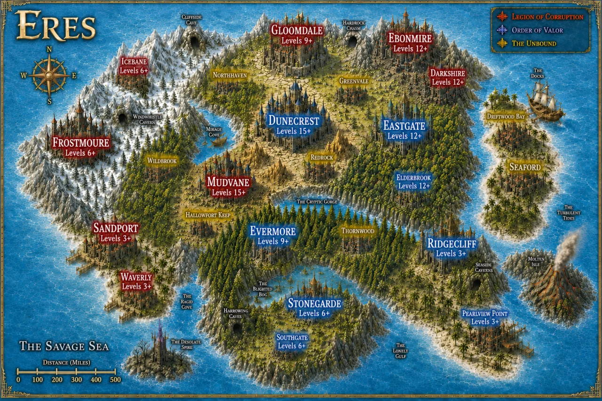

# The World of Eres

<small>Click the map to open it full size. ● Legion of Corruption · ● Order of Valor · ● The Unbound</small>

## The History of Eres

As the new land of Eres emerged, and various races began to inhabit it, they discovered a realm rich in magic and mystery, wherein a bitter conflict arose, casting a shadow over its verdant hills and serene valleys. The war that would ensue was unlike any other, a war between two mighty factions: the noble **Order of Valor** and the malevolent **Legion of Corruption**.

### The Order of Valor

The Order of Valor was a beacon of hope and righteousness. Formed by the wisest and bravest of Eres, this faction was dedicated to preserving the sanctity of the land and protecting its people. United by a code of justice, honor, and balance, they harnessed the land's mystical and mundane resources to cultivate unparalleled magical and martial prowess. Their leaders were revered not only for their strength but also for their wisdom and compassion. They sought the ancient arcane secrets, not for power, but to prolong life and ensure the prosperity of Eres, believing that knowledge was the key to a brighter future.

### The Legion of Corruption

Opposing them was the Legion of Corruption, a dark and formidable force driven by insatiable greed and a lust for power. This faction sought to dominate Eres through fear, manipulation, and dark magic. They were masters of deceit and terror, employing shadowy tactics to bend the will of the land and its inhabitants to their own twisted vision. The Legion aspired to unlock the deepest arcane secrets, not to preserve life, but to extend their own existence and impose their control over all. Their leaders were ruthless, their hearts blackened by their malevolent ambitions. They saw the world as a canvas to be reshaped according to their desires, caring little for the lives they would destroy in the process.

### The War

The war between these factions was relentless and savage. Battles raged across the land, from the snow-capped peaks of the West to the sandy coast of the East. The Order of Valor, with their gleaming armor and bright banners, stood as stalwart defenders of the realm. Their ranks were filled with knights, wizards, and heroes, each dedicated to the cause of protecting Eres from the encroaching darkness.

The Legion of Corruption, clad in dark, ominous robes and wielding forbidden magics, spread fear and chaos wherever they went. Their armies consisted of twisted creatures and corrupted beings, all bound to the Legion's dark will. They employed insidious tactics, using fear and deceit to weaken the resolve of the Order and turn the people of Eres against their defenders.

Despite such victories on both sides, the wars dragged on, with neither side able to gain a decisive advantage. The land of Eres, once a place of peace and prosperity, became a battlefield, scarred by the relentless struggle between light and darkness. Villages were razed, forests burned, and the people suffered under the weight of the conflict.

As the years passed, the war between the Order of Valor and the Legion of Corruption became more than just a battle for control of Eres. It became a symbol of the eternal struggle between good and evil, a testament to the resilience of one's spirit and the depths of one's depravity. The heroes of the Order fought not just for victory, but for the soul of Eres itself, while the Legion sought to plunge the world into an age of darkness and tyranny.

In the end, the war between these two mighty factions would determine the fate of Eres. Whether the land would be bathed in the light of justice and prosperity or shrouded in the shadow of fear and corruption depended on the courage of those who fought for what they believed in.

---

**Read on:** [The Factions & the Unbound](factions.md) · [Territories](cities.md)
